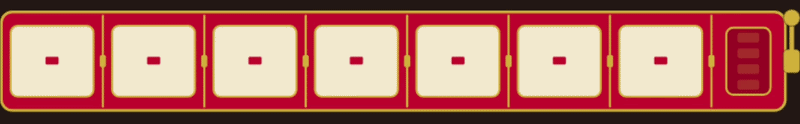
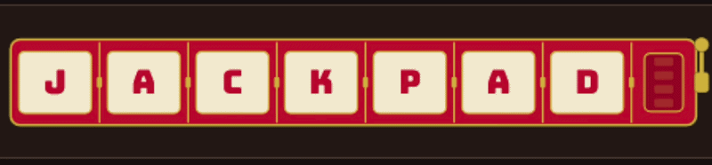
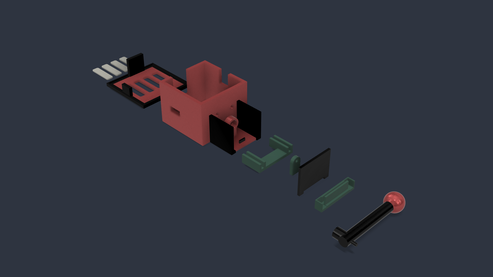
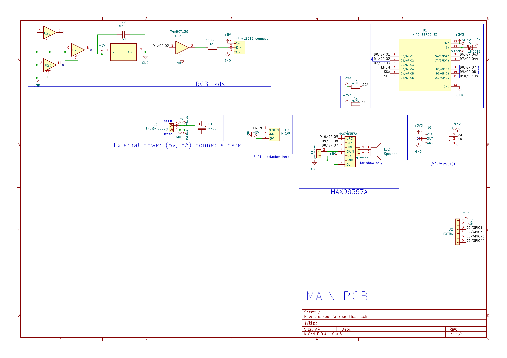
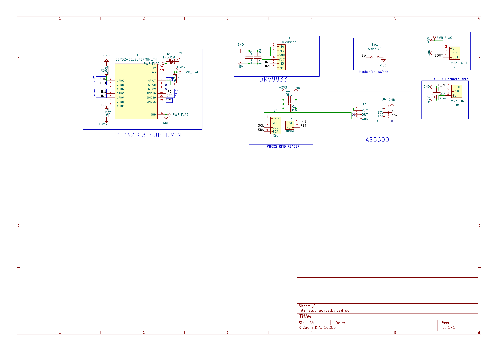

# Jackpad
Jackpad is a modular slot machine macropad. Pull the lever and the slots spin and land on a set of macros for an app, either picked at random or chosen by you. Either way, you get the satisfying mechanical spin of a real slot machine.  Snap on extra slots to make it as big as you need.

Made this for https://halflife.hackclub.com/

Slots detaching / attaching:

## Color theme (3d prints):
Retro chrome

Classic casino

## What it is / Why i made it:
- It's a macropad but in a style of a slot machine. The reason I made this is because slot machines look cool and I wanted to combine two completely different things.

## How it works:
- Two PCBs: Main (contains XIAO S3 as the main MCU, only 1 PCB) & Slot (contains ESP32-C3 supermini as the MCU, PCB quantity depends on how many macros you want)
- XIAO S3 acts as a wireless keyboard
- The main pcb has an AS5600 magnetic sensor which is the lever you pull to send signals to the ESP32-C3 for spinning motors.
- ESP32 C3's send signals to XIAO S3 via ESP-NOW (vice-versa) for button presses, motor running etc.
- The slots also have an AS5600 sensor each for positioning the motors correctly so they line the RFID tags correctly.
- Each slot also has a PN532 rfid reader along with small rfid tags which sit on a drum which spin via the motor. A single mechanical switch is present under the drum. PN532 detects a rfid tag which is our 'macro' and as you click on the button, it sends that macro to S3.
- There are limits to how many tags a SLOT can contain (due to size), but no limits to how many SLOT PCBs you can connect with each other, and that too in any order. The slots get a numbering via a 'E-IN / E-OUT' pin on each MCU which does the ordering of slots. A MR30 connector on each pcb has 3 pins: 5v/GND/ENUM for this reason.
- There are two modes: One is just randomly selecting macros, basically a slot machine for looks (though you can set the random macros to do whatever you want). Second mode is where you group different macros together; so like you have macro for music player & 4 slots are connected to main pcb so the macros are: PLAY/PAUSE/NEXT/PREVIOUS. Other group is for FUSION-360 for Sketch/Extrude/Combine/Align tool. So the groups are selected in a sequence; once u pull the lever MUSIC group gets selected, pull lever again Fusion group gets selected and so on (loops), and this is where the AS5600 sensor is most needed.

## UPDATES:
1) Week-1 completed of half-life hackclub.
2) Changed from surface mount components and individual chips to carrier board type mounts for ease of soldering.
3) Completed both main and slot pcb.
4) Completed cad model for main pcb.

## To-do:
1) Work on 3d modeling for week-2 of half-life (slot PCB remaining).

## Project files:

### PCB
1) Folder `kicad_jackpad` contains all the files for PCB/SCHEMATICS for main pcb and slot pcb.
2) Inside is another folder named `breakout_jackpad` which is the main folder. It contains the main pcb files (`breakout_jackpad.pro`) as well as slot pcb files (inside `slot_jackpad` folder).

### CAD

1) Folder `CAD` contains folder `Editable` which has .step & .f3d files for the project.
2) `Printable` contains .stl files.
3) **Notes for printing / editing**
- While viewing / editing file (I used fusion360) models with these prefix in their name need to be:
   - **ig_** : ignored while printing
   - **s_** : separately printed
   - **p_** : printed together (all names with p_ print together even if in different folders)
   - **2p_** : printed together but only with 2p_ in their name (even if in different folders)
   - **3p_**: printed together but only with 3p_ in their name (even if in different folders)

 ### CODE

 Folder `CODE` contains a `main_pcb,ino`.
 It may or may no work and i have no way to test it but as hackclub requires it I did some code for all the components.

 I used AI for AS5600 and MAX98357A as I've never worked with those before

## Jackpad BOM:

NOTE: the quantities are per PCB

| Item | Amount | Cost USD (ea.) | Use | Link |
|------|--------|------------|-----|------|
| 74AHCT125 (DIP-14) + DIP-14 socket | 1 | 0.96 | 3.3V to 5V level shifter for LED data | https://robu.in/product/sn74ahct125n-texas-instruments-8ma-1-4-5v5-5v-8ma-4-dip-14-buffers-drivers-receivers-transceivers-rohs/ |
| MX126-5.0-02P screw terminal | 2 | 0.11 | External 5V input | https://robu.in/product/xy300va-5-0-xinya-2-pin-screw-terminal-blockgreen/ |
| Male pin header strip, 2.54mm (40-pin) | 1 | 0.12 | Headers | https://robu.in/product/2-54mm-2x40-pin-male-double-row-straight-long-header-strip/ |
| Female pin header strip, 2.54mm (40-pin) | 1 | 0.10 | Mount boards | https://robocraze.com/products/40x1-female-berg-strip?_pos=3&_psq=female&_psid=89fdd915c&_ss=e |
| Male to Female jumper wires | 1 | 0.51 | Connect boards | https://robu.in/product/male-to-female-jumper-wires-40-pcs-10cm/ |
| Female to Female jumper wires | 1 | 0.51 | Connect boards | https://robu.in/product/10cm-female-female-breadboard-jumper-dupont-2-54mm-1p-1p-cable-40-pcs/ |
| PN532 RF-ID V3 Module | 1 | 2.68 | RFID reading for macro | https://robocraze.com/products/nfc-near-field-communication-rf-id-v3-module?variant=40193169096857 |
| NFC Tag Sticker \| NTAG213 (pack of 10) | 1 | 1.56 | RFID tags (macros) | https://amzn.in/d/00HLtY3b |
| 0.1uF (100nF) ceramic caps | 10 | 0.10 | Decoupling (1 on main pcb + 2 per slot pcb) | https://robu.in/product/100nf-50v-disc-capacitor/ |
| 1N5819 Schottky diodes | 2 | 0.062 | Power protection for esp32's (1 per board) | https://robu.in/product/1n5819-ap-mcc-40v-1a-600mv1a-do-41-schottky-diodes-rohs/ |
| Electrolytic caps: 470uF x2, 100uF x1, 10uF x1 | 1 | 1.44 | Power smoothing? | https://robu.in/product/aluminum-electrolytic-12-kinds-0-22μf-470μf-capacitor-assorted-kit/ |
| ESP32-C3 SuperMini | 1 | 2.67 | SLOT PCB main board | https://robocraze.com/products/esp32-c3-mini-development-board-unsoldered?variant=48465411506400 |
| Magnetic encoder sensor module AS5600 | 2 | 1.64 | Motor encoder for stopping at soecific points & one for lever | https://robu.in/product/magnetic-encoder-sensor-module-as5600/ |
| DRV8833 motor driver breakout | 1 | 0.75 | Motor control, slot board | https://robocraze.com/products/drv8833-2-channel-dc-motor-driver?variant=46651197784288 |
| N20 600 RPM Motors | 1 | 2.40 | For spinning barrels | https://robocraze.com/products/6v-n20-600-rpm-miniature-gear-motor?variant=41491539886233 |
| MR30 PCB connector (MR30PW-FEMALE, 3-pin) | 2 | 1.03 | Power in/out (1 per slot pcb + 1 in main pcb) | https://partsbaba.com/products/amass-mr30pw30-female-connector-mr30pw-f20-g-y-original-drone-connectors?variant=48877861798045 |
| MR30 PCB connector (MR30PW-MALE, 3-pin) | 2 | 1.14 | Power in/out (1 per slot pcb) | https://partsbaba.com/products/amass-mr30pw30-male-connector-mr30pw-m30-g-y-drone-connectors?variant=48784235626653 |
| MAIN and SLOT PCB ORDER | 2 | 9.30 | PCB manufacture from robu.in | https://robu.in/product/online-pcb-manufacturing-service/ |
| Battery 2500mAh 2S Li-ion | 1 | 5.98 | Power | https://robu.in/product/pro-range-18650-li-ion-2500mah-7-4v-2s1p-protected-battery-pack-3c/ |
| WS2812B LEDs | 6 | 0.05 | Lights | https://robu.in/product/ws2812b-rgb-addressable-led-module/ |
| XIAO S3 | 1 | 11.99 | Main PCB main board | https://robu.in/product/seeed-studio-xiao-esp32s3-2-4ghz-wifi-ble-5-0/ |
| M3 screws | 1 | 3.71 | Screwing printed parts and PCBs together | https://onlyscrews.in/products/m3-allen-button-head-ss304-assorted-box?variant=50368948863289 |
| CAD model print | 1 | 2.50 | 3d print | printing-legion channel |

## Schematics:

### 1) Main PCB

### 2) Slot PCB

